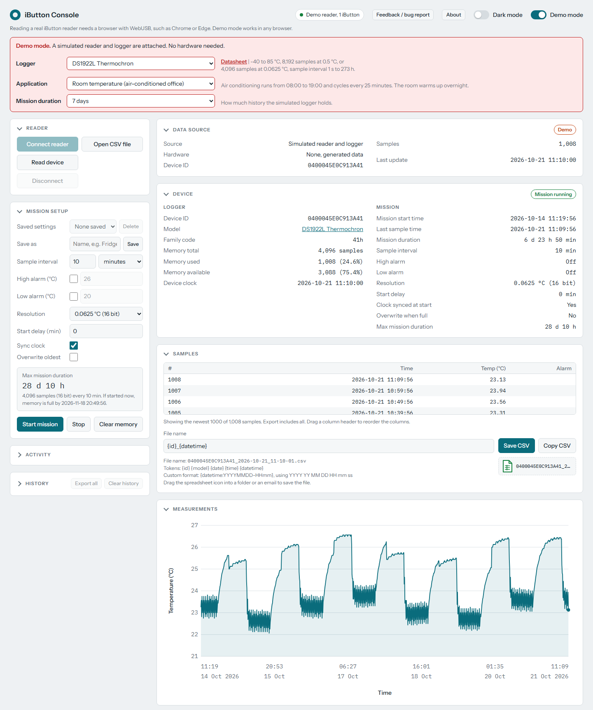

# iButton Console

A browser app for Maxim/Analog Devices iButton temperature and humidity data loggers. It reads and configures loggers through a DS9490R USB reader over WebUSB. It can also open CSV files and earlier reads. Everything runs in your browser and no data is sent anywhere.

The whole app is one file, `ibutton-console.html`. There is nothing to install or build.

**[Open the app](https://mariofrei.github.io/ibutton-console/)** in Chrome to use it right away, or download the file and open it from your computer (see below).

## Getting started

> [!WARNING]
> This app is provided "as is", without warranty or guarantee of any kind. There is no guarantee that it works correctly, that readings and exports are accurate, or that it will not change or erase data on a logger. Anyone may use it, but at their own risk. Keep your own copies of important data.

### Use it online

Open **https://mariofrei.github.io/ibutton-console/** in Chrome. The online version can also connect to the USB reader.

### Use it offline

To use the app offline or keep your own copy:

1. Open [ibutton-console.html](https://github.com/mariofrei/ibutton-console/blob/main/ibutton-console.html) on GitHub.
2. Press the **Download raw file** button (the download arrow at the top right of the file view). Or right-click [this direct link](https://raw.githubusercontent.com/mariofrei/ibutton-console/main/ibutton-console.html) and choose **Save link as...**. Keep the `.html` file extension.
3. Open the downloaded file in Chrome: double-click it if Chrome is your default browser, or drag it into a Chrome window, or press Ctrl+O (Cmd+O on a Mac) in Chrome and select the file.

Other browsers have no WebUSB, so only Demo mode works there. The file runs offline, except that it loads its fonts from Google Fonts.

### First steps

1. Turn on **Demo mode** to try the app without hardware. It simulates a chosen logger model and application, such as an office room.
2. To use a real logger, plug in the DS9490R, press **Connect reader**, pick the reader in the browser dialog, put an iButton in the reader, and press **Read device**.

### Reader setup on Windows

The browser can only use the reader when no other program is using it and its driver is WinUSB. Close OneWireViewer or any other 1-Wire software. If connecting still fails, switch the DS9490R to the WinUSB driver, for example with [Zadig](https://zadig.akeo.ie/). Other 1-Wire programs that need the Maxim driver will then stop working with that reader until you switch the driver back.

## Supported loggers

| Family | Models |
| --- | --- |
| 21h | DS1921G, DS1921H, DS1921Z Thermochron |
| 41h | DS1922L, DS1922T, DS1922E Thermochron, DS1923 Hygrochron (temperature and humidity) |
| 53h | DS1925 Thermochron |

Family 41h loggers with password protection turned on are not supported.

## Features

- **Read** the logger's device info, mission settings and all stored samples.
- **Mission setup:** sample interval, high and low alarms, resolution, start delay, clock sync and overwrite of oldest samples. You can save settings as presets. Starting a mission clears the logger's memory first. The app checks each model's limits before it writes to the logger.
- **Stop** a running mission or **clear** the logger's memory. Clearing asks you to confirm.
- **Chart, stats and table** for temperature, humidity or both. You can drag the alarm lines on the chart to change the thresholds.
- **CSV export** with templated file names such as `{model}_{id}_{datetime}`. You can save, copy or drag out the file.
- **Open CSV files** in read-only mode. This works with files exported by this app and with any CSV that has timestamp and temperature columns.
- **History:** every read is saved in the browser by device ID and read time, and you can export all saved reads at once.
- Light and dark mode, plus a feedback form that writes a bug report for you to copy or email. Nothing is sent automatically.

## Data storage

Settings, presets and history stay in your browser (localStorage and IndexedDB) and are never uploaded. If you clear the browser's site data, they are deleted.

## License

MIT License. See [LICENSE](LICENSE). Copyright (c) 2026 Mario Frei.

Large language models were used to write and revise the code and text of this app, including Anthropic's Claude through Claude Code.
